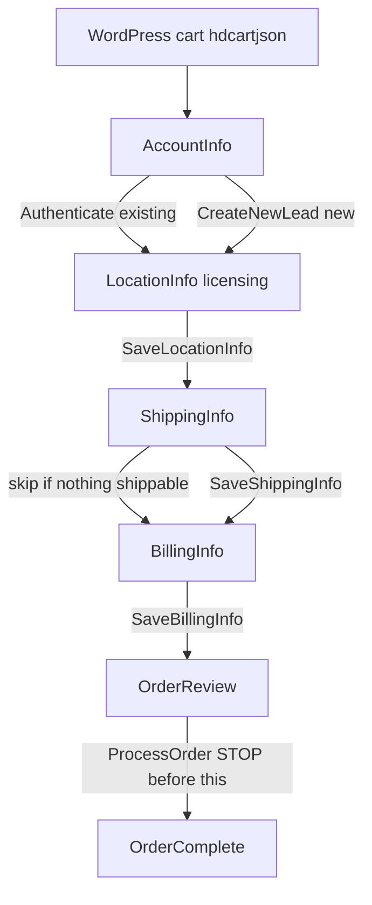

# ProCheckout field contract (investigation)

Walked 17 Sep 2026. Started on [SYB WordPress](https://dynamicmediamusic.com/syb/), submitted a real cart, signed in as a returning customer, stopped at Billing (no card, no `ProcessOrder`, no Create Account).

This is the CRM contract we cannot change. The WordPress look is not the target UX.

## How checkout actually starts

WordPress does **not** send the shopper to AccountInfo with an empty cart. The WooCommerce cart page has:

- Hidden field `hdcartjson` — base64 of the WAPF cart object (the payload you already had).
- Submit `name="dmcartsubmit"` labeled **Proceed to Checkout**.

That post lands on `https://shopsiriusxm.dynamicmediamusic.com/ProCheckout/AccountInfo` with the cart in session. A generic “checkout” link that does **not** submit `hdcartjson` opens AccountInfo with whatever leftover CRM cart that customer already had.

Coming from SYB, the same Vue app is branded “Shop Syb” (Dynamic Media + Soundtrack, red). Direct AccountInfo without that handoff is the SiriusXM-blue shell. Same steps, different skin.

## Pages and APIs

Progress bar: **View Cart → Licensing → Shipping → Billing & Payment → Review Order**.

| Step | URL | Load | Save | Next |
|------|-----|------|------|------|
| Sign in / create | `/ProCheckout/AccountInfo` | `GetAccountInfo` | `Authenticate` or `CreateNewLead` | LocationInfo |
| Licensing | `/ProCheckout/LocationInfo` | `GetLocationInfo` | `SaveLocationInfo` | ShippingInfo |
| Shipping | `/ProCheckout/ShippingInfo` | `GetShippingInfo` | `SaveShippingInfo` | BillingInfo (skipped when `IsSaleHasShipping` is false) |
| Billing | `/ProCheckout/BillingInfo` | `GetBillingInfo` | `SaveBillingInfo` / `CreateBillingGroup` | OrderReview |
| Review | `/ProCheckout/OrderReview` | `GetOrderReview` | `ProcessOrder` | OrderComplete |

Also used: `ValidateAddress`, `SaveNewSite` (add location), `ResetPassword`, `UpdateBillingAddress`. Logout: `SybLogOut` vs `LogOut`.

View-models (source of truth for field names): `/ViewModels/ProCheckout/AccountInfo.js`, `LocationInfo.js`, `ShippingInfo.js`, `BillingInfo.js`, `OrderReview.js`.

## AccountInfo fields

**Returning (do not change names):**

- `username` / Vue `EMail`
- `password` / Vue `Password`
- POST `Authenticate` `{ EMail, Password }`
- LOGIN is a clickable div, not a native submit button.

**New customer (observed, not submitted):**

- `businessName`, `firstName`, `lastName`, `phoneNumber`, `Phone2`
- `emailAddress`, `password` (min 6)
- SMS: `chkSMSBilling`, `chkSMSPromotion`, `chkSMSService` (Billing and Service default on)
- POST `CreateNewLead` `{ businessName, contactInfo: { FirstName, LastName, CustomerName, Email, Password, Phone1, Phone2, BillingSmsOptIn, ServiceSmsOptIn, PromotionSmsOptIn } }`

Forgot password: `usernameForgot` → `ResetPassword`.

## LocationInfo (licensing) fields

Each cart product needs a **site**:

- Dropdown `product_0`, `product_1`, … bound to `Cart.Data.Products[i].SiteID`
- **Add New Address** → `SaveNewSite` with `siteName`, `address1`, `city`, `state`, `zip`, `industry` (UPS validate first)
- Satellite items also show `esn_*` (Radio ID). Soundtrack app/PlayerOne did not.

This is the add-a-location UI: pick an existing site from the address book or create a new one. Identity of the **customer/program** is the logged-in `CustomerID`, not a field on this page.

POST `SaveLocationInfo` body is `Cart.Data` (products with `SiteID` set).

## ShippingInfo

Shown only if any sale part is `Shippable`. App-only Essential skipped this and went straight to billing.

Save: `{ shippingStrings }` from per-site shipping dropdowns. Can `CreateContact` for a ship-to person.

## BillingInfo fields (stopped here)

New payment method (no saved billing group on the test account):

- `bgName` — nickname
- `ccNumber`, `ccName`, `ccMonth`, `ccYear`, `ccCVV`
- Billing address: `address1`, city, `state`, `zip` (line 2 also present)
- NEXT → `CreateBillingGroup` / `SaveBillingInfo { billingGroupID }` → OrderReview

Did **not** fill or submit these.

## OrderReview (from JS only, not clicked)

Acknowledgements required before `ProcessOrder`:

- `chkToS` — Dynamic Media terms
- `chkSYBToS` — Soundtrack Your Brand terms
- `chkRecurring` — recurring subscription charge

`ProcessOrder` `{ shippingInfoList }` → `OrderComplete`. Do not call this from investigation.

## What the WordPress payload becomes in CRM

WAPF `PartID` labels (`0561`, `0565`, `0566`) are **SKU codes**. CRM uses integer `PartID`s. `photoID` becomes `ImageUrl`.

One Woo line becomes a cart product **plus AddOns** (music, messaging, warranty).

| Woo product | WAPF PartID | CRM product | CRM AddOns seen |
|-------------|-------------|-------------|-----------------|
| Soundtrack Essential (`product_id` 2001083) | `0561` | **1025** Customer Owned SYB Player Setup (No Hardware), $34.95 | **1010** SYB Essential Monthly Music Service - Primary, $34.95, recurring |
| PlayerOne (`product_id` 2003636) | `0566` | **1144** Soundtrack Your Brand PlayerOne Music Player, $179.99 | **1010** music $39; **166** $9.99 (messaging); **169** $59.99 (5-year warranty) |

Your original sample used Essential `product_id` 2003638 / PartID **0565** at $39 — a different Woo product than today’s Essential page (`0561` / $34.95). Same handoff shape.

`GetBillingInfo` expanded the Essential line into two `SaleParts` (1025 + 1010) on `SaleID` 223027. Recurring flags live on the sale part (`PartCycle`, `PartCycleMode`).

## Program / franchise hook (still missing)

Public SYB checkout does **not** send a franchise program id. After login, the cart is just products on that CRM customer. No salesman, campaign, or Broken Yolk id appeared in AccountInfo or LocationInfo.

For program landing pages we still need CRM to tell us:

- Which integer PartIDs (and WAPF-style SKU codes if the ingest still wants `056x`) are the Broken Yolk $54.99 rate and $199 PlayerOne.
- How a new franchisee is attached to the parent customer/program (existing CustomerID, hidden field, price profile, or something else).

Staging frontend: the program landing page asks **PlayerOne vs existing player** in a modal and builds the cart. `/checkout/` is a **generic Dynamic Media** stand-in for ProCheckout (View Cart → AccountInfo with sign-in, create account, and forgot password → LocationInfo / SaveNewSite → ShippingInfo if shippable → BillingInfo → OrderReview). Branding uses the DM app tokens and logo, not the program landing page. While `placeholders` is true, nothing is POSTed to production ProCheckout. The eventual live handoff is the same shape WordPress uses (`hdcartjson` → AccountInfo with the cart already attached).

## What we may restyle vs what must stay

**May restyle:** layout, copy, progress, SYB vs franchise branding, how options are picked on the landing page.

**Must keep for CRM:** the JSON endpoints and property names above; a cart that CRM can turn into `PartID` + AddOns; site/licensing address; payment group fields; the three review acknowledgements. If we stop posting `hdcartjson`, we need an equivalent ingest the CRM team already supports.

## Placeholder PartIDs (replace with IT)

Until production catalog values exist, Broken Yolk uses **fictitious** SKUs in [`public/programs/brokenyolk.json`](../public/programs/brokenyolk.json). Staging checkout must not POST these to ProCheckout.

| Role | skuCode | crmPartId | Price |
|------|---------|-----------|-------|
| Franchise music (monthly) | `9BY1` | 91010 | $27.95 |
| App / PC / Sonos player | `9BY2` | 91025 | $0 |
| PlayerOne hardware (not corporate-covered) | `9BY3` | 91144 | $129 one-time per player |
| Overhead messaging (monthly) | `9BY4` | 90166 | $5 |

Swap `skuCode` and `crmPartId` (and set `placeholders: false`) after IT review. Do not reuse live SYB parts (`0561`/`1025`/`1144`) for franchise rates.

## Not done this pass

- OrderReview / OrderComplete UI on production ProCheckout (on purpose).
- ShippingInfo UI on production (app-only skips it).
- Create Account on production.
- Live Broken Yolk PartIDs from CRM.
